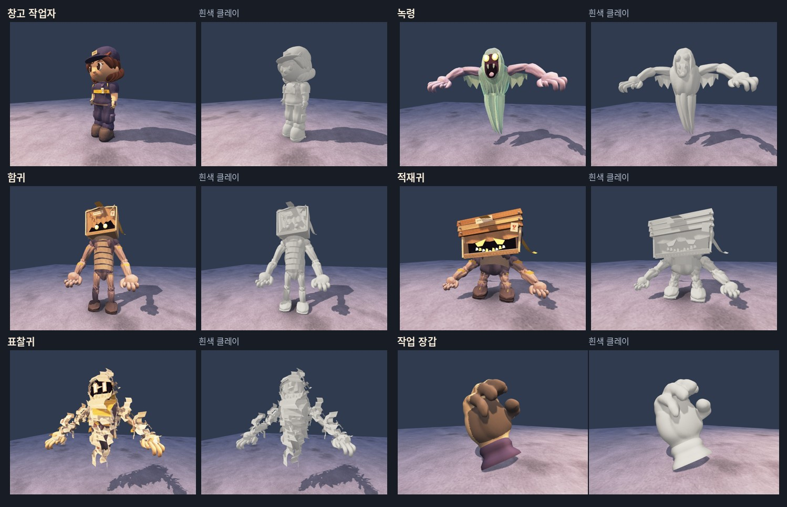

# GDG · 모델과 플레이 검수

작업자, 녹령, 함귀, 적재귀, 표찰귀, 작업 장갑을 게임의 WebGL2 렌더러로 촬영했다. 아래 비교표의 각 쌍은 같은 모델과 포즈다. 왼쪽은 게임 재질, 오른쪽은 흰색 클레이다.

## 조형

- 작업자 [정면](worker-0.jpg) · [사선](worker-45.jpg) · [왼쪽](worker--90.jpg) · [오른쪽](worker-90.jpg) · [뒷면](worker-180.jpg)
- 장갑 [펴기](glove-flex-0.jpg) · [굽히기](glove-flex-100.jpg) · [게임 재질](glove--42.jpg)
- 귀신 [녹령](flicker-12.jpg) · [함귀](boxhead-12.jpg) · [적재귀](imp-12.jpg) · [표찰귀](wraith-12.jpg)

빈손 장갑은 한 손당 18,704개 삼각형으로 닫힌 표면 하나를 이룬다. 양손에 대해 여섯 단계의 굽힘을 검사했다. 삼각형으로 계산한 전체 부피는 편 손 대비 최대 1.91% 증가했다. 이 수치는 손가락별 국소 변형과 시각적 품질까지 보증하지 않는다. [메시 검사 기록](../../modeling/mesh-report.json)

| 안정된 파지 자세 | 엄지 | 검지 | 중지 | 약지 | 소지 |
| --- | ---: | ---: | ---: | ---: | ---: |
| 상자 양손, 왼손 | 3.99 | 4.00 | 4.00 | 4.00 | 4.00 |
| 상자 양손, 오른손 | 3.99 | 4.00 | 4.00 | 4.00 | 4.00 |
| 상자 한 손, 왼손 | 2.99 | 2.10 | 3.05 | 3.25 | 3.15 |
| 손전등, 오른손 | 4.46 | 4.50 | 4.32 | 4.30 | 4.32 |

단위는 mm다. 게임이 읽는 장갑 삼각형의 꼭짓점, 변의 중점, 삼각형 중심을 표본으로 사용했다. 각 값은 손끝 기준점의 19mm 이내에 있는 표본에서 해당 상자 면 또는 손전등 몸통까지 측정한 최소 간격이다. 손전등 스위치와 가드의 관통 검사도 별도로 수행했다. [표본 수와 거리](../../modeling/contact-report.json)

[기존 모델과 이번 변경 비교](before-after-models.jpg). 위쪽은 `71f99e0`에서 가져온 메시이며 아래쪽은 이번 변경이다. 두 소스를 현재 검수실의 같은 포즈와 조명으로 렌더링했다. 기준 커밋에 전신 작업자 검수 모델이 없어 이 비교는 귀신 네 종과 장갑을 포함한다.

## 실제 플레이

검수 스크립트가 시작 위치, 장비, 조우할 귀신을 지정하고 Chromium에 입력한다. 이동과 등반, 접촉, 낙하, 착지, 장비 교환은 게임 루프로 처리한다. 영상은 실제 캔버스의 프레임을 VP8 WebM으로 기록했다.

- [창고 및 C-01 장비·난간 통과 영상](handling.webm) · [손전등 파지](forward.jpg) · [한 손 운반](annex-dual.jpg)
- [창고 상층부](warehouse-catwalk.jpg) · [경사로](warehouse-ramp.jpg) · [팔레트 화물](warehouse-cargo.jpg) · [C-01 운반 중 난간 넘기](annex-rail-carry.jpg)
- [C-01 귀신 조우와 선반 등반·은신 영상](encounters.webm) · [선반 위](upper-shelf.jpg) · [시야 차폐](shelf-cover.jpg) · [옆으로 나왔을 때](shelf-peek.jpg)
- [네 귀신의 공격 준비부터 회복·소멸까지](creature-cycles.webm) · [상태별 실제 위치와 시각](creature-cycles.json). 같은 C-01 통로에서 종류별로 짧은 등장 수명을 지정하고 뒤로 달려 공격을 피했다. 적재귀는 순찰 중 발견 즉시 돌진 준비에 들어가며 다른 세 종류는 경계 단계를 거친다.
- 창고 입구 [수정 전](before-spawn.jpg) · [수정 후](after-spawn.jpg)

## 물리와 입력 회귀

- 창고와 C-01에서 실제 W와 Space로 상층부·경사로 난간과 낮은 화물을 넘었다. 한 손 운반과 손전등을 유지한 채 난간을 통과하고, E로 내려놓기·회수·배송까지 진행했다.
- 자동 검사에서 정면과 대각선 질주, 0.45·0.96·2.355m 연속 등반, 상층부 낙하와 착지, 머리 공간이 막힌 곳에서 서기 차단, 열린 공간에서 원래 높이 복귀를 확인했다. 높은 벽, 막힌 착지, 낮은 천장에서는 넘기를 거부했다.
- 30·60·120·144Hz에서 Q 역전환 20회와 E 동작 20회를 검사했다. 소유권은 E 동작마다 한 번 변경됐다. 30·60·120Hz에서 배송 5건, 기존 버니합·에어 스트레이프·충돌 슬라이딩·점프 버퍼 테스트도 통과했다. [실행 기록](checks.txt)

## 성능과 검증 범위

데비안 x86-64, 2 vCPU, Chromium 156, 하드웨어 GPU가 없는 SwiftShader에서 측정했다. 두 버전 모두 창고 시작 지점, 640×416 뷰포트, PERFORMANCE와 75% 배율, 336×218 내부 캔버스에서 40개 프레임 간격을 기록했다.

| 소스 | 평균 FPS | P95 프레임 시간 |
| --- | ---: | ---: |
| 기준 커밋 71f99e0 | 1.65 | 692.8ms |
| 이번 변경 | 1.71 | 669.9ms |

[측정 전](before-timing.json) · [측정 후](after-timing.json)

일반 데스크톱 GPU에서의 60 FPS는 추가 실기 검수가 필요하다. 정지 파지의 5mm 기준과 전환 중 상자 내부 침투 검사는 각각 다른 측정이다. 장비 전환에는 손목 궤적과 IK를 공유하는 자세별 메시가 사용되므로, 모든 중간 프레임에서 같은 토폴로지나 손끝 5mm 간격을 보장하지 않는다. 기준 브랜치에서 확인한 표찰귀의 특수 반응은 손전등 퇴각이었다. 기획서가 언급한 상자 배치 전용 소멸 트리거는 기존 소스와 저장소 문서에서 확인되지 않아 이번 검증 범위에서 제외했다.
